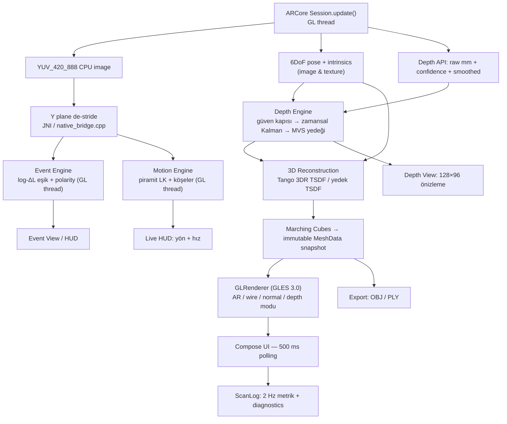

# Teknik Mimari

Bu belge `NeuroVision` Android uygulamasının modüler yapısını, veri akışını, iş parçacığı modelini, koordinat dönüşümlerini ve JNI arayüz sözleşmelerini tarif eder. Yığının temeli: ARCore (kamera + 6DoF + derinlik) → yerel C++ motor (`librecon.so`) → GLES 3.0 renderer → Jetpack Compose arayüzü.

---

## 1. Modül haritası

| Modül | Katman / durum | Sorumluluk ve ana dosyalar |
|---|---|---|
| **Camera Engine** | ARCore + Kotlin — **mevcut** | `ReconSurfaceView.kt`, `ReconGlRenderer.kt`. `Session` yaşam döngüsü UI thread'de; `Session.update()`, `acquireCameraImage()`, derinlik/güven görüntüleri GL thread'inde. YUV_420_888 CPU görüntüsü, Y düzlemi, poz, intrinsics. |
| **Event Processing Engine** | Yeni native `event/` — **mevcut** | Log-parlaklık eşiği, DVS tarzı referans takibi, pozitif/negatif polarity, event hızı/yoğunluğu, ARGB önizleme tamponu. |
| **Motion Tracking Engine** | Yeni native `motion/` — **mevcut** | 4 seviyeli görüntü piramidi + Lucas–Kanade, grid tabanlı Shi-Tomasi/Harris, medyan akış, px/s hız ve baskın yön. Gerçek metrik hız ARCore pozundan okunur. |
| **Sensor Fusion** | ARCore VIO — **mevcut** | Kamera + IMU füzyonu ARCore içinde yapılır; uygulama ham IMU'ya erişmez, metrik 6DoF pozu tüketir. |
| **Depth Engine** | Yerel C++ — **mevcut** | ARCore Depth API (raw 16-bit mm + 8-bit confidence + smoothed) birincil; `mvs/census.cpp`, `mvs/stereo.cpp`, `mvs/refine.cpp` ile yedek MVS. Zamansal Kalman füzyonu ve güven kapısı `core/engine.cpp` içinde. |
| **SLAM / Tracking** | ARCore — **mevcut** | 6DoF poz, düzlem bulma, `Frame.hitTest`, relokalizasyon ve poz süreklilik denetimi (>2.5 m/s görünen hızda atlama). |
| **3D Reconstruction** | Yerel C++ — **mevcut** | `tango/tango_recon.cpp` (Apache-2.0 çekirdek, `dlopen`) birincil TSDF + Marching Cubes; `tsdf/voxel_hash.cpp`, `tsdf/integrator.cpp`, `mesh/mesher.cpp` yedek hat. |
| **World Model** | Yerel `Engine` durumu + Kotlin state — **kısmen** | `core/engine.h` (depth/filter/mask/block/mesh durumları), `ReconMetrics`, `ReconAnchor`, `ScanLog`. Oturumlar arası kalıcılık bu sürümde yok (Aşama 7 hedefi). |
| **Rendering** | GLES 3.0 — **mevcut** | `gl/renderer.cpp`: OES kamera arka planı, kalıcı mesh VBO/EBO, dinamik yüzey VBO'su, AR/wireframe/normal/depth-heatmap modları, world-locked anchor işaretleri. |
| **UI** | Jetpack Compose — **kısmen** | `ReconScreen.kt`, `ReconHud.kt`, `ReconControlBar.kt`, export/anchor sheet'leri. `aim.md` bölüm 9'daki 5 ekran hedeftir; bu derlemede **Live / Event / Depth / 3D / Diag** beş ekranı ve render modları (AR overlay, wireframe, normals, depth heatmap, free-orbit 3D world) vardır. |
| **Export** | Yerel C++ — **mevcut** | `io/exporter.cpp`: OBJ (renk + normal) ve PLY (ASCII, renkli); kaynak dizin `files/exports/`. |
| **Diagnostics / logging** | Kotlin + native — **mevcut** | `ScanLog.kt`, faz sayaçları (`phase` 1–6), `stall` tespiti, güvenli mod (safe mode), `runMeshSelfTest()` + `runPerceptionSelfTest()` (6/6 PASS), 2 Hz oturum logu. |

---

## 2. Veri akışı

**Kritik noktalar**

- Her kare yalnızca bir kez işlenir; ARCore aynı derinlik haritasını 2–3 render karesinde tekrar yayınlayabilir. Yeni derinlik zaman damgası yoksa füzyon atlanır (`dup=` sayacı).
- Zamansal filtre "tahmin" piksellerini saklar ama bunları rekonstrüksiyona **vermez**; boşluk doldurma yalnızca görsel önizlemede kullanılır.
- Renk, CPU görüntüsünün luma düzleminden örneklenir; derinlık ızgarası kamera dokusuna hizalıdır, CPU görüntüsüne değil.
- Mesh anlık görüntüsü (snapshot) immutable yayınlanır; renderer ve export aynı anda tutarlı veri okur.

---

## 3. İş parçacığı modeli

| Thread | İş | Not |
|---|---|---|
| **UI / main** | `MainActivity`, Compose, izinler, ARCore `Session` oluşturma/`resume`/`pause` | `Session.update()` burada çağrılmaz; ARCore oturumu UI thread'de kurulur (ARCore gereksinimi). |
| **GL (GLSurfaceView)** | `onDrawFrame`: `Session.update()`, görüntü/depth/confidence alımı, `NativeRecon.submitFrame()`, `NativeRecon.render()` | Ekran yenileme hızında çalışır (hedef 60 FPS). **Event ve motion bu MVP'te bu thread'te çalışıyor**; maliyet `ev_ms` / `motion_ms` ve native self-test ile ölçülüyor, Aşama 8'de oturum loguna yazılıyor. Bütçe aşılırsa native worker'a taşınmalıdır. |
| **Native worker (`Engine::workerLoop`)** | `prepare → fuse → feed → integrate → mesh → remesh`, MVS, carving, dinamik maske, preview güncelleme | `submitFrame` kuyruğa alır; `cv_` ile uyandırılır. Ağır adımlar kısılır: carving ~1 s / 35 cm, mesh ≤300 ms aralık (hedef). `phase_` atomik değeri donmayı teşhis eder. |
| **UI polling (Compose `LaunchedEffect`)** | `NativeRecon.getStats`, `depthPreview`, `getDiagnostics`, `ScanLog.log` | 500 ms aralıkla (2 Hz). Donma tespiti: 6 s boyunca `framesProcessed` artmazsa `stall phase=...` yazılır. |
| **Mesh self-test thread** | `NativeRecon.runMeshSelfTest()` | Açılışta bir kez, 1.5 s gecikmeyle; kendi reconstruction örneğini kurar, canlı oturuma dokunmaz. |

**Senkronizasyon sözleşmesi:** Görüntü düzlemleri JNI'da kopyalanıp `FrameInput` içine taşınır; GL thread'i buffer'ı hemen kapatabilir. Mesh/dinamik mesh `shared_ptr<const MeshData>` ile yayınlanır; preview tamponları ayrı mutex ile korunur.

---

## 4. Koordinat sistemleri ve dönüşümler

| Frame | Tanım | Kullanım |
|---|---|---|
| **OpenGL kamera** | X sağ, Y yukarı, −Z ileri. `camera.pose`, `getViewMatrix()` | ARCore pozu, anchor yerleşimi, renderer |
| **Tango optik kamera** | X sağ, Y aşağı, Z ileri | Tango 3DR `updateFromPointCloud` girdisi |
| **Dünya (ARCore world)** | Oturum bazlı metrik dünya | Mesh köşeleri, dışa aktarma, kamera yörüngesi |
| **Görüntü pikseli** | Y-aşağı, sol üst köken, `rowStride`/`pixelStride` | CPU YUV düzlemleri, derinlik ızgarası |

### Dönüşümler

1. **Poz:** `camera.pose.rotationQuaternion` → `FrameInput.qx..qw` (x,y,z,w) ve `translation` → `tx,ty,tz`. OpenGL → Tango optik dönüşümü kamera X ekseni etrafında **180°** rotasyonla yapılır: `(x, y, z) → (x, −y, −z)`. Bu dönüşüm olmadan harita aynanın arkasına füzyonlanır.
2. **Nokta bulutu:** Derinlik ızgarası kendi intrinsics'iyle doğrudan **kamera optik frame**'ine unproject edilir; poz çekirdeğe bırakılır. Noktaları dünya koordinatına önceden çevirip pozu da göndermek çift dönüşüme yol açar (referanstaki v2.8 hatası).
3. **Derinlik ızgarası:** 160×90 mertebesinde, kamera **dokusuna** hizalıdır. Intrinsics `Camera.getTextureIntrinsics` değerlerinin derinlik çözünürlüğüne ölçeklenmesiyle elde edilir (`depthInfo[6..9]`). CPU intrinsics'iyle unproject geometriyi gerer.
4. **Affine eşleme:** `frame.transformCoordinates2d(IMAGE_PIXELS → TEXTURE_NORMALIZED)` üç köşe ile `u = a·x + b·y + c`, `v = d·x + e·y + f` katsayıları üretir (`depthInfo[0..5]`). Ekran/CPI oranı farklıysa derinlik görüntüsü CPU görüntüsünün dikey kırpmasıdır.
5. **Renk örnekleme:** CPU görüntüsü normalizasyonundan doku normalizasyonuna aynı affine ile geçilir; luma `Y` düzleminden okunur.
6. **Y-aşağı koordinatlar:** Derinlik ve luma ızgaralarında satır indeksi aşağı doğru artar; TSDF'ye verilmeden önce optik frame'e uygun hale getirilir.

---

## 5. Arayüz sözleşmeleri

### 5.1 JNI (`NativeRecon.kt` ↔ `jni/native_bridge.cpp`)

`System.loadLibrary("recon")`; tüm metodlar `JNI_OnLoad` içinde `RegisterNatives` ile kaydedilir. Handle, GL bağlamı başına bir `NativeContext`tir.

| Kotlin metodu | C++ karşılığı | Sözleşme |
|---|---|---|
| `create(): Long` | `nativeCreate` | `Engine` + `GLRenderer` içeren `NativeContext` ayırır. |
| `destroy(handle)` | `nativeDestroy` | Renderer'ı `abandon()` edip context'i siler. |
| `glInit(handle): Boolean`, `glShutdown(handle)` | `nativeGlInit`, `nativeGlShutdown` | GLES 3.0 kurulumu; başarısızlık `onError` üretir. |
| `submitFrame(...)` | `nativeSubmitFrame` | Y/U/V, width/height, zaman damgası, q/t, K, tracking, depth/confidence/smooth depth, `depthInfo[10]`. Stride doğrulanır; bozuk stride'lı kare reddedilir. Boyutu uymayan confidence/smooth ızgaraları sessizce düşürülür. |
| `render(handle, tex, view, proj, uv, w, h, mode, anchors): Boolean` | `nativeRender` | Statik + dinamik mesh snapshot'larını renderer'a verir. `mode`: 0 AR, 1 wire, 2 normal, 3 depth heatmap. |
| `getStats(handle, floats, ints)` | `nativeGetStats` | `floats = [processMs, fps]`; `ints = [keyframes, triangles, vertices, blocks, framesProcessed, depthSource, phase]`. |
| `setScanning`, `reset`, `exportMesh(path, format)`, `hasMesh` | ilgili native metodlar | `depthSource`: 0 yok, 1 ARCore, 2 MVS. `phase`: 0 idle, 1 prepare, 2 fuse, 3 feed, 4 integrate, 5 mesh, 6 remesh. |
| `depthPreview(handle, depthOut, confOut)` | `nativeDepthPreview` | 128×96 ARGB tamponları doldurur (`Engine::kPreviewW/H`). |
| `getDiagnostics(handle): String` | `nativeDrainDiagnostics` | Birikmiş tanılama satırlarını boşaltır. |
| `runMeshSelfTest(): String` | `nativeRunMeshSelfTest` | Deterministik sentetik sahne testi; canlı kamerayı kullanmaz ve oturum logundan ayrı raporlanır. |

### 5.2 Yerel sınıflar

| Sınıf / dosya | Sözleşme |
|---|---|
| `recon::Engine` (`core/engine.h`) | Tüm rekonstrüksiyon durumunun sahibi. `submitFrame(FrameInput&&)`, `mesh()`, `dynamicMesh()`, `exportMesh()`, `preview()`, istatistik accessor'ları, `drainDiagnostics()`. Kopyalanamaz; worker thread'i kendine aittir. |
| `recon::FrameInput` (`core/frame.h`) | De-stride edilmiş Y/U/V, poz, `Intrinsics K`, `depthMm`, `confidence`, `smoothDepthMm`, `depthTransform[6]`, `Kdepth`. `valid()`, `hasDepth()`, `hasConfidence()`, `hasSmoothDepth()` doğrulayıcıları. |
| `TangoRecon` (`tango/tango_recon.h`) | `dlopen` ile yüklenen çekirdek; `updateFromPointCloud`, mesh çıkarma, 3 cm voksel / 6 m menzil. |
| `VoxelHash` / `TSDFIntegrator` / `MeshBuilder` | Yedek hat: 2 cm voksel, ±5 cm truncation, 20 000 blok, inkremental Marching Cubes. |
| `KeyframeManager`, `StereoEngine`, `DepthRefiner` | Yalnızca MVS yolu: 14 karelik referans penceresi, Census + 8-yol SGM, 5×5 joint bilateral. |
| `GLRenderer` (`gl/renderer.h`) | GLES 3.0 çizim; kamera arka planı (`samplerExternalOES`), mesh VBO/EBO, dinamik yüzey, anchor işaretleri. |
| `ScanLog` (`ScanLog.kt`) | Oturum dosyası, `session_end=clean`, `session_resume`, güvenli mod, rapor dosyaları, paylaşım. |

---

## 6. Fallback zinciri ve hata davranışı

1. ARCore kurulamazsa → açılış ekranında açık hata mesajı; **sahte poz üretilmez**.
2. Depth API desteklenmiyorsa → `depthMode = DISABLED`, yerel MVS; HUD `MVS depth` der.
3. Tango çekirdeği `dlopen` ile yüklenemezse → yerel TSDF + Marching Cubes; logda `t3dr=no_geometry`.
4. Derinlik zaman damgası ilerlemezse → kare füzyonu atlanır; filtre durumu korunur.
5. Relokalizasyon şüphesi (>2.5 m/s) → kare ve sonraki 3 kare füzyondan çıkarılır.
6. Önceki oturum `session_end=clean` olmadan bittiyse → güvenli mod; log paylaşılabilir, ARCore başlatılmaz.

---

## 7. Bilinçli sınırlar

- **Oturum bazlı dünya:** TSDF hacmi ve anchor'lar bellekte yaşar; yeni açılışta sıfırdan tarama gerekir.
- **5 ekran hedefi:** Mevcut Compose arayüzü Live / Event / Depth / 3D / Diag beş ekranını içerir; Event / Diagnostics ekranları Aşama 1 ve 8 işidir.
- **Event/motion ölçümü cihazda:** `event/` ve `motion/` modülleri artık mevcuttur; kalan
  iş, maliyet ve scene-change davranışının gerçek cihaz oturumlarında doğrulanmasıdır.
- **iOS:** `aim.md` hedefidir; bu derleme yalnızca Android'tir.
- **Bulut servisi yok:** Tüm işlem cihaz üzerindedir; ağ bağımlılığı yoktur.
